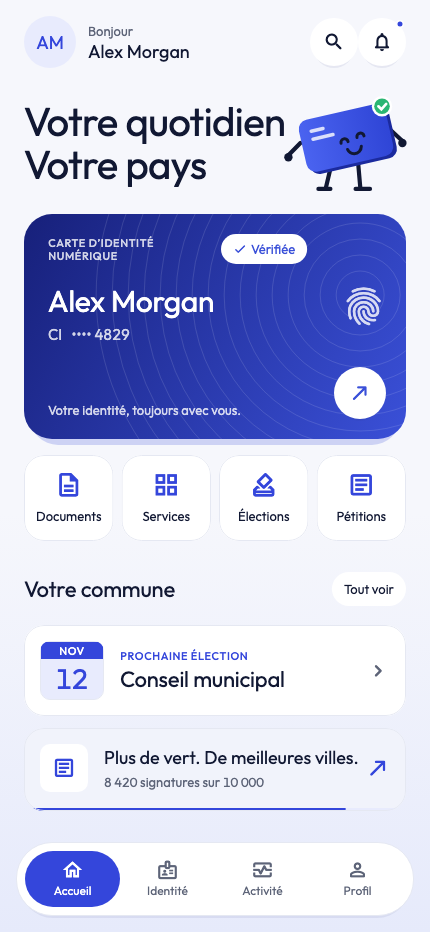
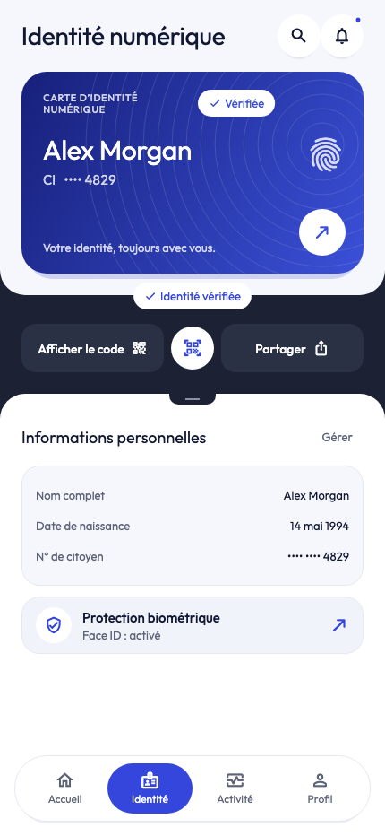
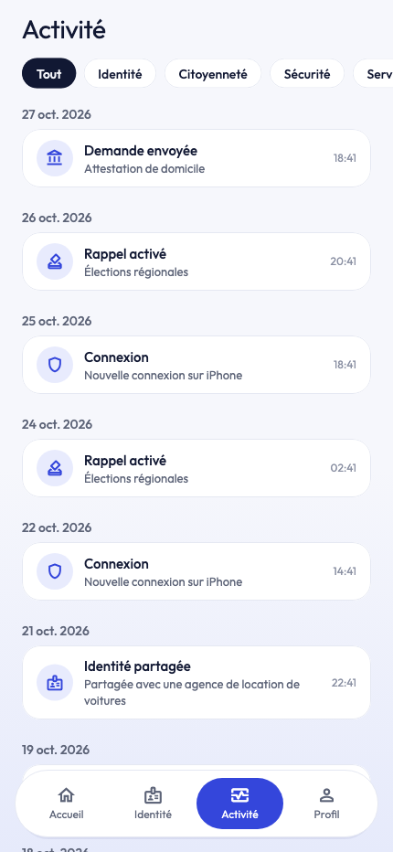
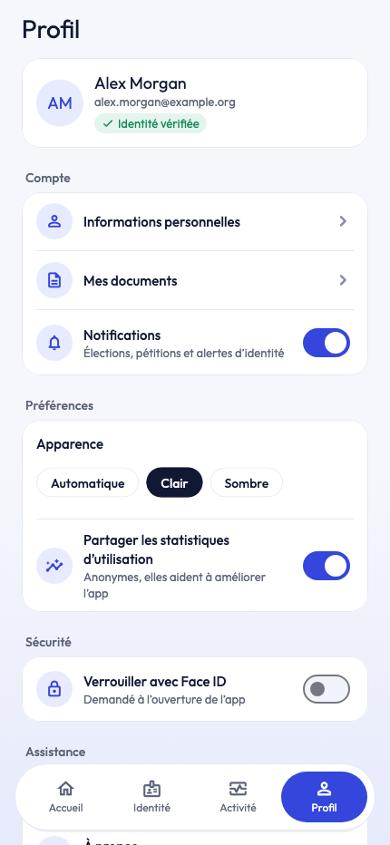
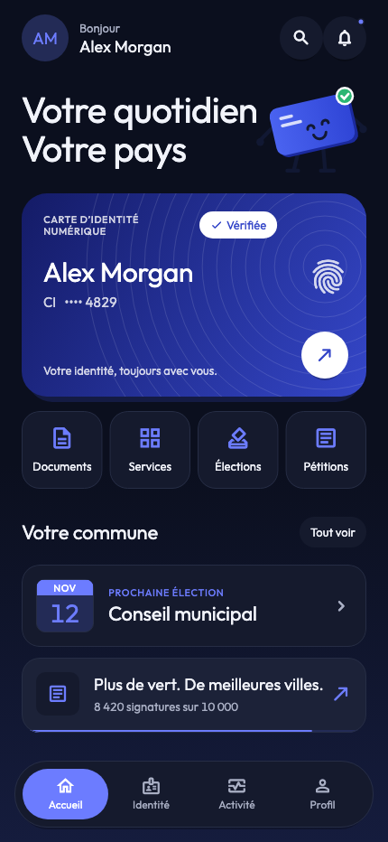
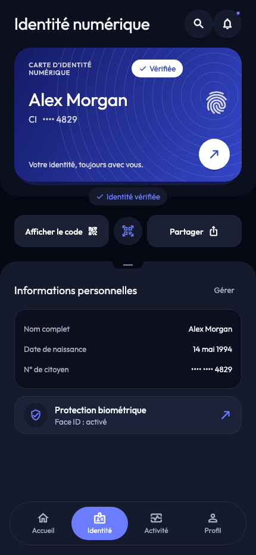
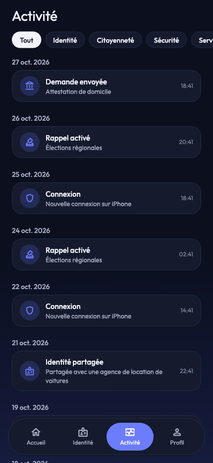
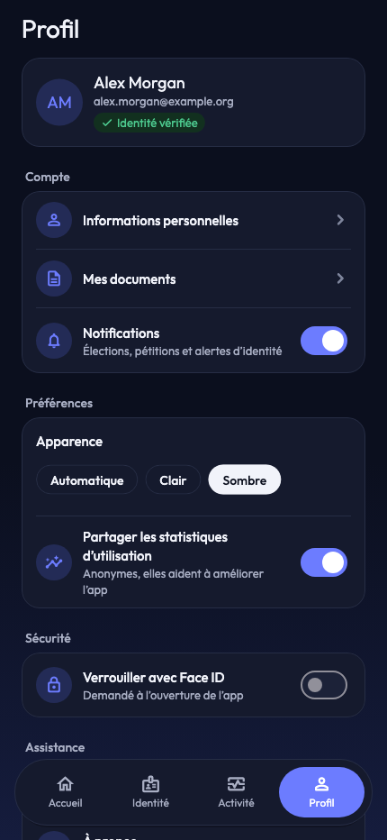

# Votaa — digital ID & civic life, any back-end

Flutter app (iOS + Android): a digital citizen ID, upcoming elections,
petitions, public services and documents.

It is **front-end first**: it runs entirely on a built-in simulator on the
first launch, and plugs into **any** back-end (REST, GraphQL, Firebase,
Supabase, your own server) by implementing a few interfaces — screens never
change.

| Home | Digital ID | Activity | Profile |
| --- | --- | --- | --- |
|  |  |  |  |
|  |  |  |  |

## Run it (demo mode)

```sh
flutter pub get
flutter run
```

No account, key or service needed. Sign in with a demo account shown on
the sign-in screen.

### Demo accounts and magic values

| Where | Value | Result |
| --- | --- | --- |
| Sign-in | `alex.morgan@example.org` / `demo1234` | verified citizen |
| Sign-in | `sam.lee@example.org` / `demo1234` | identity pending |
| Sign-in | any other password | "E-mail ou mot de passe incorrect" |
| Sign-in | `locked@example.org` | "Too many attempts" (rate limit) |
| Sign-up | `taken@example.org` | "This email is already used" on the field |
| Check an ID | code `000000` | "This code is not valid" |
| Personal details | phone `+000000` | refused by the server, under the field |
| Service request | note containing `reject` | refused, under the field |
| Petition | *Keep the old market hall* | closed: signing is refused |
| Election | *Old Town by-election* | over: reminder refused |

### Scenario panel

In demo mode, a small **DEMO** tab sits on the right edge of the screen.
Tap it, then tap a scenario: normal, empty lists, slow loading, server
error, network down, session expired, rate limit, validation refused.
Every screen state is two taps away. "Expire the access token" shows the
silent renewal.

The simulated device "has biometrics": an Approve / Fail sheet stands for
Face ID.

## Plug your back-end

One line to switch:

```sh
flutter run --dart-define=BACKEND=rest --dart-define=API_BASE_URL=https://api.example.org/v1
# or
cp config/dev.example.json config/dev.json   # git-ignored
flutter run --dart-define-from-file=config/dev.json
```

- REST: implement [`docs/api_contract.yaml`](docs/api_contract.yaml) on your
  server, nothing to change in the app.
- Anything else (Firebase, Supabase, GraphQL): see
  [`docs/BACKEND.md`](docs/BACKEND.md) — implement the interfaces, declare
  them in `lib/backend.dart`, run the contract tests.

## Architecture

```
Screens (presentation) ──read──▶ Controllers (application) ──call──▶ Interfaces (domain)
                                                                        ▲
                         lib/backend.dart picks ONE implementation ─────┤
                                                                        ├─ data/mock  (simulator, default)
                                                                        ├─ data/rest  (reference, documented)
                                                                        └─ yours
```

```
lib/
  main.dart, bootstrap.dart   error handlers, fresh-install wipe, container, runApp
  backend.dart                THE plug point (overrides per back-end)
  app/                        router (routes.dart = every route), shell, global hooks,
                              offline banner, scenario panel
  core/                       config, Failure, session, storage, state tools
                              (PaginatedNotifier, ActionController, OfflineFirstNotifier,
                              cacheFor, watchFresh), network (ApiClient + interceptors),
                              services (analytics, push, crash, biometrics… empty defaults)
  design_system/              tokens (colors, type, spacing), light/dark theme, components
  features/<name>/
    domain/                   pure Dart: models, repository interface, rules
    data/mock/, data/rest/    implementations (+ shared JSON codec)
    application/              Riverpod providers and controllers
    presentation/             screens
    <name>.dart               public surface for other features (only import allowed)
  mock/                       simulator engine: seed, latency, scenarios, session, events
  l10n/strings.dart           every visible text, grouped by screen
  shared/                     cross-feature widgets (paged list, failure view…)
```

Rules: screens never import `data/`; controllers only know interfaces;
`domain/` is pure Dart; `core` knows no feature; `design_system` knows
neither; a feature imports another only through its `<name>.dart` barrel.

Global behaviours are widgets without UI, stacked in `App.builder` in a
documented order (`lib/app/app.dart`): text-scale clamp, lifecycle
(refresh after 30 s, re-lock), opened routes (push, shortcuts), analytics,
offline banner, app lock, scenario panel.

## Brand it

- Colors: `lib/design_system/tokens/app_colors.dart` (light + dark).
- Font: `lib/design_system/tokens/app_typography.dart` + `pubspec.yaml`
  (Outfit is bundled, OFL licence in `assets/fonts`).
- Illustration: `CardMascot` in `lib/design_system/components/brand.dart`.
- Screens contain no color, size, margin or duration of their own.

### App name, identifiers, icon

| What | Where |
| --- | --- |
| Name shown under the icon | `ios/Runner/Info.plist` (`CFBundleDisplayName`), `android/app/src/main/AndroidManifest.xml` (`android:label`), `APP_NAME` define |
| Bundle id / application id | `ios/Runner.xcodeproj/project.pbxproj` (`PRODUCT_BUNDLE_IDENTIFIER`), `android/app/build.gradle.kts` (`applicationId`, `namespace`) and the Kotlin package folder |
| Icon | replace `ios/Runner/Assets.xcassets/AppIcon.appiconset` and `android/app/src/main/res/mipmap-*` (or use `flutter_launcher_icons`) |

Current values: name **Votaa**, bundle id / application id
**`sergio.votaa.app`** (Kotlin package `sergio.votaa.app`). A fork must
choose its own.

### Language

The interface is in **French** (`lib/l10n/strings.dart`, locale `fr_FR` in
`appLocale`: dates, numbers and system widgets such as the date picker
follow it). Adding a language = moving these classes to ARB files with
`flutter gen-l10n`.

## Tests

```sh
flutter analyze         # zero warnings
flutter test            # everything (goldens rendered on macOS)
flutter test --exclude-tags golden     # on Linux/Windows CI
flutter test --update-goldens test/screenshots   # after a visual change
```

- `test/helpers/pump_app.dart` starts the whole app (real router and
  controllers) on the simulator, with size, text scale, session, scenario
  and fake services.
- `test/contract/` — the same suites against the simulator **and** the REST
  implementation (through an HTTP server backed by the simulator). Run them
  against yours.
- Layouts at 320×568 @130 %, 430×932 (and @200 %), 820×1180; touch targets;
  light and dark goldens.

## Security

- Session only in the Keychain / Keystore, "this device only", never
  synced; Android backups off.
- Fresh install on iOS (Keychain survives uninstall): secure storage wiped
  on first launch; updates keep the session.
- Sign-out wipes session, offline copies, caches and account preferences.
- Offline copies are stored in the Keychain / Keystore and expire after
  7 days.
- Optional app lock (biometrics / passcode); sensitive sheets use
  `FLAG_SECURE` on Android and hide while the screen is recorded on iOS.
- No secret in the repository (`.gitignore` ready, `.env.example`).
  HTTPS is mandatory except `localhost`.

## External services

All behind interfaces in `lib/core/services/`, with an empty default — the
app runs without any third-party account. Override them in
`lib/bootstrap.dart`:

| Service | Interface | Default | Example provided |
| --- | --- | --- | --- |
| Analytics | `Analytics` | nothing sent | `BatchingApiAnalytics` |
| Problem report | `ProblemReporter` | prefilled e-mail | `ApiProblemReporter` |
| Crash reports | `CrashReporter` | debug console | — |
| Push | `PushService` | none | — |
| Biometrics | `DeviceAuthenticator` | unavailable (simulated in demo) | — |
| QR scanner | `QrScanner` | none (code typed by hand) | — |
| Icon shortcuts | `AppShortcuts` | none | — |

## Licence

[Apache License 2.0](LICENSE) — see also [NOTICE](NOTICE).

Anyone may use, modify and redistribute the code, including in commercial
or closed apps, as long as they keep the licence and the NOTICE and state
their changes. Contributors grant a patent licence, and the licence does
**not** give the right to use the name "Votaa" or its logo (forks rebrand).

The bundled Outfit font is under the SIL Open Font Licence
(`assets/fonts/OFL-Outfit.txt`).
